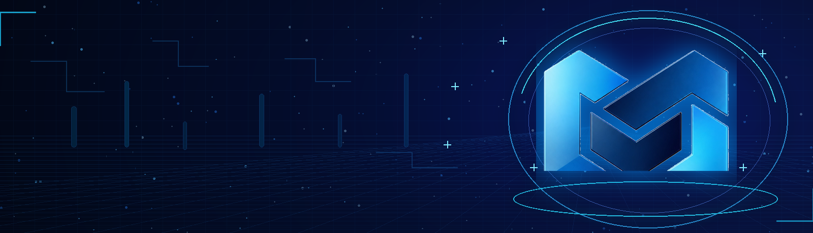
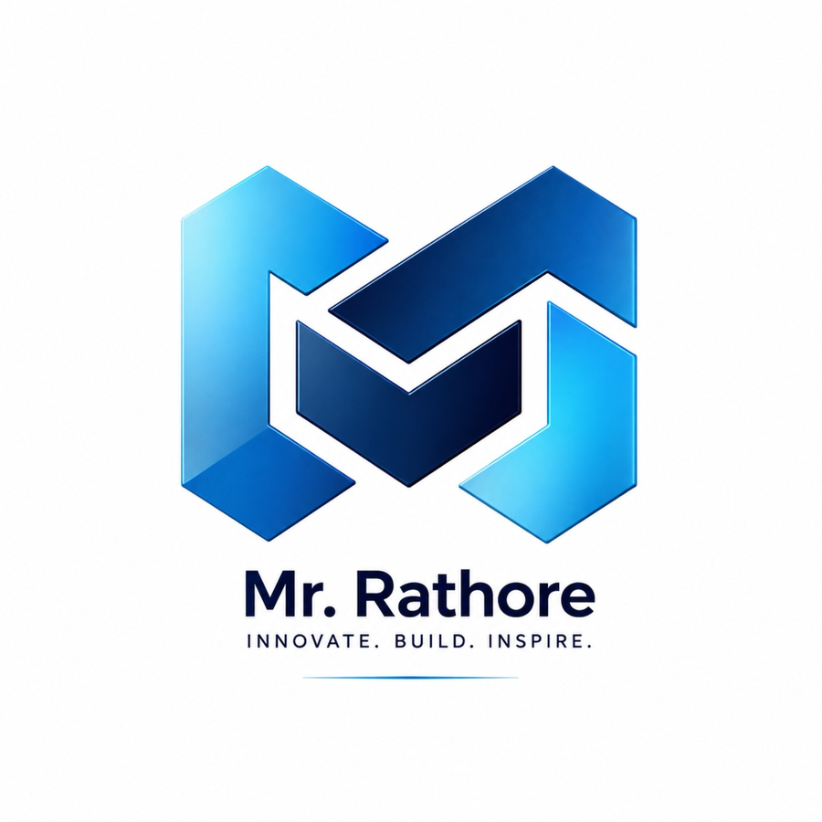

<div align="center">

  <!-- HERO BANNER -->
  

  <br><br>

  <!-- BRAND LOGO -->
  

  <h1>MR.RATHORETEC</h1>

  <!-- TYPING SVG SUBTITLE -->
  <a href="https://github.com/rmahipalsingh602-spec">
    
  </a>

  <br><br>

  <!-- INTERACTIVE BADGES -->
  <p>
    <a href="https://github.com/rmahipalsingh602-spec">
      
    </a>
    <a href="https://mr-rathore-com-tech.netlify.app/" target="_blank">
      
    </a>
    <a href="https://github.com/rmahipalsingh602-spec?tab=repositories">
      
    </a>
    <a href="mailto:rmahipalsingh602@gmail.com">
      
    </a>
  </p>

  <p>
    <em>⚡ Transforming complex ideas into production-ready software, intelligent agents, and interactive worlds.</em>
  </p>

</div>

---

## ◈ EXECUTIVE PROFILE & CORE PILLARS

I'm **Mahipal Singh Rathore**, an independent engineer, researcher, and software architect building at the frontier of **Artificial Intelligence, Modern Web, Game Engines, and 3D Systems**.

I focus on creating modular, testable, high-performance software — taking architectures from concept to functional prototypes and full-scale deployments.

<div align="center">

| 🤖 **AI & Autonomous Agents** | 🌐 **Web & Cloud SaaS** | 🎮 **Game Systems** | 🌌 **3D & Interactive Web** |
|:---:|:---:|:---:|:---:|
| Assistants · Local LLMs · Multi-Agent Flows | Modern UI/UX · Scalable APIs · SaaS Architecture | Gameplay Systems · Physics · Real-time Engines | Three.js · WebGL · Shaders · Blender |
| *Python · PyTorch · Agents* | *Next.js · React · FastAPI* | *C++ · C# · Unity · Systems* | *WebGL · Three.js · 3D Canvas* |

</div>

---

## ◈ FEATURED PROJECTS

<table>
  <tr>
    <td width="50%" valign="top">
      <h3>🤖 NETRA — AI Platform</h3>
      <p>Modular AI assistant framework featuring local LLM inference, dynamic tool orchestration, contextual document reasoning, and automated developer workflows.</p>
      <p>
        <a href="https://github.com/rmahipalsingh602-spec/Netra-v1-">
          
        </a>
      </p>
      <sub><strong>Stack:</strong> Python · Local AI · Tool Execution · Agentic Reasoning</sub>
    </td>
    <td width="50%" valign="top">
      <h3>🌐 NETRAWEBAI — AI Web Builder</h3>
      <p>Next-generation automated web generator transforming high-level conceptual prompts into responsive, production-ready web interfaces with modern design patterns.</p>
      <p>
        <a href="https://github.com/rmahipalsingh602-spec/netrawebai">
          
        </a>
      </p>
      <sub><strong>Stack:</strong> React · Next.js · UI/UX · SaaS · Automation</sub>
    </td>
  </tr>
  <tr>
    <td width="50%" valign="top">
      <h3>🧠 RAIN AGI — Multi-Agent System</h3>
      <p>Experimental agentic architecture focused on deep reasoning graphs, persistent memory recall, autonomous task planning, and distributed tool usage.</p>
      <p>
        <a href="https://github.com/rmahipalsingh602-spec/RainAGI">
          
        </a>
      </p>
      <sub><strong>Stack:</strong> AGI Research · Multi-Agent Protocols · Memory Graphs</sub>
    </td>
    <td width="50%" valign="top">
      <h3>🎙️ DNA AI — Multi-Lingual Assistant</h3>
      <p>Real-time conversational voice assistant capable of multi-language understanding, audio streaming, and seamless backend API integrations.</p>
      <p>
        <a href="https://github.com/rmahipalsingh602-spec/dna_ai">
          
        </a>
      </p>
      <sub><strong>Stack:</strong> Voice AI · Python · FastAPI · Audio Processing</sub>
    </td>
  </tr>
  <tr>
    <td width="50%" valign="top">
      <h3>🎮 EKARSHINGA — 3D & Game Platform</h3>
      <p>Interactive web-based gaming showcase and asset delivery hub featuring 3D asset previews, real-time rendering, and fluid animations.</p>
      <p>
        <a href="https://github.com/rmahipalsingh602-spec/Ekarshinga-Game-Store">
          
        </a>
      </p>
      <sub><strong>Stack:</strong> Three.js · WebGL · Game Engines · Interactive UI</sub>
    </td>
    <td width="50%" valign="top">
      <h3>🔗 RATHOLINK & DBOOK — Ecosystem Tools</h3>
      <p>Connected developer utility ecosystems and local retail management software built with clean architectural principles and high usability.</p>
      <p>
        <a href="https://github.com/rmahipalsingh602-spec/RathoLink">
          
        </a>
      </p>
      <sub><strong>Stack:</strong> Full-Stack · Node.js · APIs · Utility Architecture</sub>
    </td>
  </tr>
</table>

---

## ◈ TECHNICAL TOOLBOX

### 💻 Core Programming Languages
<p>
  
</p>

### 🤖 AI, Machine Learning & Intelligence
<p>
  
  
  
</p>

### 🌐 Frontend & Full-Stack Web Engineering
<p>
  
</p>

### ⚙️ Backend, Cloud & Databases
<p>
  
</p>

### 🎮 3D, Game Engines & Creative Design
<p>
  
</p>

### 🛠️ Developer Environment & Tooling
<p>
  
</p>

---

## ◈ ENGINEERING METHODOLOGY

```text
  ┌──────────────┐     ┌──────────────┐     ┌──────────────┐     ┌──────────────┐
  │   01. IDEA   │ ──> │ 02. ARCHITECT│ ──> │  03. BUILD   │ ──> │   04. TEST   │
  └──────────────┘     └──────────────┘     └──────────────┘     └──────────────┘
                                                                        │
  ┌──────────────┐     ┌──────────────┐     ┌──────────────┐            │
  │   07. SHIP 🚀│ <── │ 06. OPTIMIZE │ <── │  05. DEBUG   │ <──────────┘
  └──────────────┘     └──────────────┘     └──────────────┘
```

> **Core Philosophy:** *Learn deeply. Build boldly. Ship continuously.*  
> Prefer clean, modular, and maintainable systems over fragile complexity.

---

## ◈ GITHUB ANALYTICS & METRICS

<div align="center">
  <table border="0">
    <tr>
      <td align="center">
        
      </td>
      <td align="center">
        
      </td>
    </tr>
  </table>

  <br>

  

  <br><br>

  
</div>

---

## ◈ 2026 ROADMAP & TARGETS

```text
[████████████████░░░░]  Modular Autonomous AI Agent Frameworks (NETRA & RAIN)
[██████████████░░░░░░]  Advanced 3D WebGL / WebGPU Interactive Portals
[██████████████████░░]  Production-grade SaaS Architectures & Web Deployments
[████████████░░░░░░░░]  Physics-driven Gameplay Systems & Simulation Engines
[████████████████░░░░]  High-performance C++ & Python Tooling
```

---

## ◈ CONNECT & COLLABORATE

<div align="center">

  <a href="https://github.com/rmahipalsingh602-spec">
    
  </a>
  <a href="https://mr-rathore-com-tech.netlify.app/" target="_blank">
    
  </a>
  <a href="mailto:rmahipalsingh602@gmail.com">
    
  </a>

  <br><br>

  <h3><strong>INNOVATE. BUILD. INSPIRE.</strong></h3>
  <p><sub>MR.RATHORETEC · Designed for High-Impact Software Engineering</sub></p>

</div>
